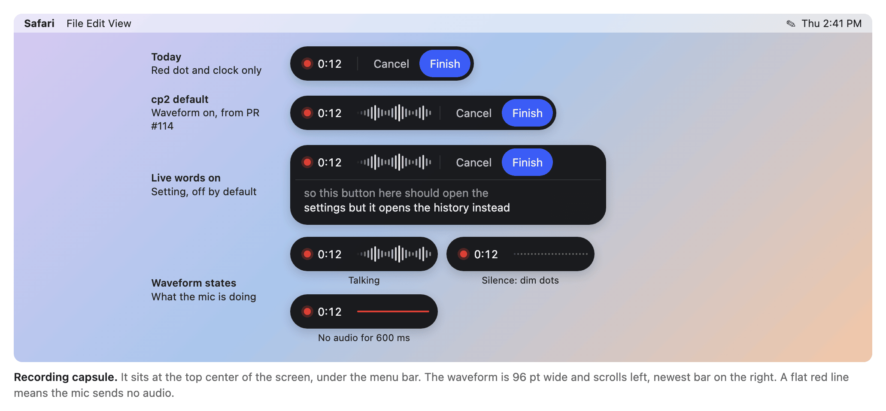
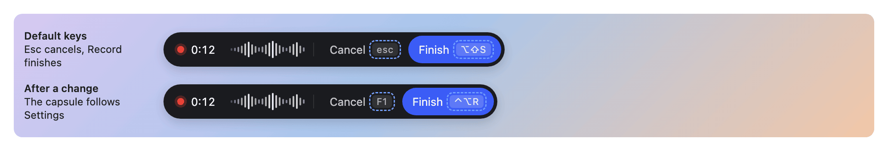

# Capture: shortcuts, Mac recording, displays

Read this before changing `src/shortcut.rs`, `src/pause.rs`, `src/capture.rs`, `src/screens.rs` or the picker and capsule placement in `src/ui.rs`.

## Shortcuts (`src/shortcut.rs`, `is_capture_shortcut` in `src/capture.rs`)

A press of `⌥⇧S` (or the shortcut set in Settings), however long it's held, records the display under the pointer as soon as its modifiers come up, auto-cropped, with a brief red edge glow from the overlay as the start cue, and the capsule springs open onto switch chips (Area · Window · Screen · iPhone if cabled; `shortcut::Reveal` and its `REVEAL_*` constants) until 3.5 s pass or the user clicks, scrolls or draws (never while hovered). A chip (`switch_recording`) restarts rather than retargets: Window/Area discard the few seconds and morph the capsule into the picker, iPhone discards and starts the phone.

Recording starts on the release rather than the press so nothing is captured while ⌥⇧ is still down (⇧ is the ink key), and Esc before the release cancels. The picker opens only from the menu's **Choose What to Record…** (or a chip), on the pointer's display and on the mode last used; there the shortcut records what it's on, and repeats of a held S never record (`handle_selection_key`'s `repeat`). While recording, a press finishes, ignoring one within 400 ms of the start.

Carbon hotkeys and the key event tap report presses through `emit_capture_shortcut` (deduplicated within 90 ms); while a press waits for its release the UI loop polls the modifiers and takes the cancel key from the key tap (`tick_shortcut`, `take_escape`), so the release is seen whichever window has focus. The cancel key (Esc unless Settings › Shortcuts set F1 to F12) from the key tap also closes an open picker when another app has the keys, and pauses, resumes or cancels a recording (next section); the picker's GPUI keys and the pill take the same key, and the Review window's Esc-to-close stays Esc. The tap stamps each press as it arrives (`note_cancel`), ignoring a held key's repeats, and the UI loop takes them with their times (`take_cancel_presses`), so two quick presses are still two when the loop is late.

Undo, cancel and draw are matched only in the key tap (Windows: the keyboard hook) and the HID poller, never through Carbon or `RegisterHotKey`. They are swappable atomics on `SharedCaptureTelemetry` (`undo_combo`, `cancel_key`, `draw_mask`), so a change in Settings works on the next key press. The draw modifier held alone shows the laser and inks on a drag, and with a click drops a pin (`capture::draws`). When it comes down with another modifier (`draw_in_chord`, as in ⌥⇧S with ⇧ drawing), ink waits until it is let go. The recording capsule shows the cancel key after Pause or Resume, the same key twice after Cancel, and the Record shortcut after Finish (`pill::model::Keys` in `Pres::Recording`).

## Pause and resume (`src/pause.rs`)

While recording, one press of the cancel key pauses and the next resumes; two presses within 400 ms (`DOUBLE_PRESS_MS`) throw the recording away, recording or paused. Annotator only watches the key, so it still reaches the app under the pointer: an Esc that closes a dialog in the app being shown pauses the recording instead of losing it. The Record shortcut and Finish end a paused recording as usual. Before a recording (the picker) and in the Review window the key means what it did. Windows and Linux keep the key as cancel.

- `pause::classify` is the timing rule, a pure function of the last press's time and this one's: `Single`, `Double` (under 400 ms after the last), or `Echo` (under 40 ms: one press reported by two sources, such as the key tap and the capsule's own key handler, which is never a double press).
- `pause::Session` is the recording's state machine (`Recording`, `Paused`, `Finishing`, `Cancelled`), owned by `ActiveRecording`. A single press acts at once, so the capsule answers the key; the second press of a double cancels whatever the first did. The capsule's Pause or Resume button is `toggle`, its Cancel button `cancel`, and `finish` hands back the pauses as `pause::Cuts`. A pause Finish is pressed in is left without an end (`Span::OPEN`): the screen and the microphone stop a few hundred ms after the press (after Accessibility work drains), so each track is cut from where the pause began to its own real end, and the window log keeps nothing it saw in that pause. `ScrawlCoordinator::apply_pause_change` is the only place that acts on a change.
- The capsule (`Pres::Recording { paused }`): the dot stops pulsing and dims, the timer stands still (`ActiveRecording::shown_ms`), the lead says Paused, the waveform and the words leave, and the first chip reads Resume. The chips are Pause or Resume `esc`, Cancel `esc esc`, Finish `⌥⇧S`, with the keys from Settings. `cargo test a_paused_capsule` draws it offscreen (`SCRAWL_PILL_STILLS=DIR` writes the stills).

**Paused time is cut at finish, not skipped while recording.** Nothing stops during a pause: the movie, the microphone and the window log go on, on the one capture clock, and `Session` only notes when each pause began and ended. At finish `Cuts` takes those spans out of every timeline, so each loses exactly the same milliseconds and they stay in sync:

| Timeline | How the pauses come out |
|---|---|
| Clicks, drags, scrolls, keys, ink, pins | `cut_events`, `cut_strokes`: what began in a pause is dropped, the rest moves earlier |
| Candidate frames | `cut_frames` drops every frame taken in a pause; none is kept during a pause anyway (`CandidateBuffer::set_paused`), so a long pause doesn't thin the rest. When that leaves none (paused before the first frame and never resumed), `ScreenRecording::cut` puts in one blank frame of the same size, never a paused image |
| `recording.mp4`, the iPhone's `recording.mov` | `cut_movie` → `scrawl-helper cut MOVIE --out FILE --keep FROM-TO,…`: an `AVMutableComposition` of the kept ranges of every track, exported pass-through (samples copied, not re-encoded: 0.11 s for a 2 minute, 172 MB movie with two pauses; a cut between keyframes is trimmed by the edit list, which AVFoundation and ffmpeg both follow, `scripts/check-movie-cut.sh`). `videoOffsetMs` and the phone's `offset_ms` move with it (`on_clock_from`) |
| `audio.wav` and the transcript | `RecordedAudio::cut` drops the paused samples before transcription, so the words are on the cut clock; a live transcription that heard the pauses is dropped. The microphone opens some hundred ms after the capture clock starts, so the audio carries its own start (`RecordedAudio::offset_ms`: the first buffer's arrival less how long before that CPAL's timestamp says its first sample was captured, which counts the device's latency as well as the buffer) and the pauses are moved onto its clock first (`on_clock_from`), as for a movie. Every engine times words from the WAV's first sample, so `transcribe::heard` moves the transcript `offset_ms` later, onto the capture clock, in one place for Apple, Deepgram, Hex and a command |
| The window log | `ActivityLog::cut`: the recording resumes on the windows as they were when it resumed (`cut_states`); cursor samples from a pause are dropped |
| `durationMs` | `Cuts::shift` |

The other way is to stop each recorder while paused and keep a running offset. That needs a pause in four recorders that start and stop at their own pace (ScreenCaptureKit's recording output can't pause, so the movie would be written in segments and joined), and each would lose a slightly different span, which is how audio and video drift apart. One list of spans on one clock, applied once, can't drift, and the live path stays as it was. The cost: the pause is on disk until finish, the microphone's indicator stays on, and the movie is rewritten once (only when a pause happened).

While paused nothing is taken in (`SharedCaptureTelemetry::pause_input` ends a stroke or drag in progress and turns `active` off, so no click, ink or key is recorded and the draw modifier does nothing), and what was already drawn stays on screen (`overlay_live`). A movie that can't be cut is deleted rather than kept with its pauses, so the keyframes then come from the candidates; an iPhone capture fails instead. `cargo test pause::` covers the press rule, the state machine and every cut.

## Mac captures (`src/capture.rs`)

The sampler keeps only small candidates (480 px long edge, in a `CandidateBuffer` capped at 384 MB that thins evenly and halves its sampling rate when full, never dropping the start or click/stroke frames). At finish the chosen keyframes are decoded from `recording.mp4` at native size (2560 px Screen, 1280 px Window/Region, never above the display's own scale, so a 1x 1920 pt display records 1920 px), shifted by `videoOffsetMs` (when the movie started on the capture clock); if decoding fails the candidates are used. macOS prompts over a Screen or Area capture (`windows::system_prompts_over`: UserNotificationCenter, SecurityAgent; ScreenCaptureKit's "bypass the system private window picker" alert comes back every 30 days) are left out of the recording through the content filter when ScreenCaptureKit lists them, frames that may show one are dropped from the candidates (`CandidateBuffer::drop_since`), and clicks on them aren't recorded. `scrawl capture-sim` drives this headless for memory and timing checks.

## ⇧ ink and pins (`track_shift_ink`, `shift_down`, `shift_up` in `src/capture.rs`, `src/laser_overlay.rs`)

Annotator watches input, and keeps one kind of press from the app: a left press that starts with the draw modifier alone, inside the capture target, while a recording takes input. That press drops its pin or draws its ink, and the app under the pointer never gets its click, its drags or its release (**Draw clicks** below). Every other key and click reaches the app. The 120 Hz poller (`run_global_hid_poller`) reads the modifier flags, and ⇧ counts only when it is down alone and is not left over from a chord such as `⌥⇧S`. ⇧ here is the draw modifier: Settings › Shortcuts can make it ⌥, ⌃ or ⌘ (`"shortcuts": {"draw": …}`, `draw_mask`), and every rule below then holds for that key.

- **Ink:** while ⇧ is down and the pointer moves inside the capture target, `track_shift_ink` draws one stroke, with or without a mouse button down. Letting go of ⇧ commits it when it spans 6 pt or more. A pointer on another display draws nothing: a capture belongs to one display.
- **Pin:** a left press that goes down while ⇧ is already down, moves under 12 pt and comes up within 1 s (`is_pin_click`). Pins are numbered 1, 2, 3 in the order they drop in the recording (`Stroke.pin`).
- **A click after a line keeps both:** every ⇧-click drops a pin, also when the hold has already drawn ink. The ink before the press becomes a stroke that ends at the press (`ink_before`, 6 pt or more, without the click's jitter) and comes before its pin in `strokes`; ink after the click starts a new stroke. So ⇧ first, then a move to the target, then a click, gives one line and one pin.
- **More pins in one hold:** each ⇧-click drops the next pin, and the lines between the pins stay. For pins alone, let go of ⇧ between the clicks.
- **Nothing by design:** ⇧ pressed after the button is already down, with the pointer still, records neither ink nor a pin.
- **Live:** a dropped pin pulses once (`sketch::pin_pulse`, 350 ms) and shows as a red disc 22 pt across in a white ring with its number in white, whole for 2 s, then fading over 0.5 s (`sketch::pin_badge`). The shader takes the numbers from a coverage texture made when the first pin drops (`pin_label_texture`). The overlay window is left out of the recording, so the video never shows ink or pins; keyframes and exports draw them again from `scrawl.json`. The Windows overlay still shows the pulse only.

**Draw clicks.** The key tap (`spawn_key_tap`, an active tap on the Accessibility grant) also takes left mouse down, dragged and up (`left_button_kept`) and modifier changes. At a press, `blocks_draw_press` keeps it when `blockDrawClicks` is on (read when the recording starts, default on), the recording takes input (not paused), the draw modifier alone is held and is not left over from a chord, the press is inside the target's rectangle, and it lands on what is being recorded (**On the target** below). A kept press starts as `shift_down` would, its drags are kept, and its release ends it as `shift_up` would. A pause or finish during a kept press drops the press but keeps the rest of it from the app until the button comes up. Presses Annotator posts itself pass. Every left press on the Mac passes the tap, so it takes no lock and reads no window list until the setting, the recording, the modifiers and the rectangle say it could be a draw-press. When in doubt a press passes: a pin that didn't drop costs a click, a press kept by mistake costs the app its click.

- **On the target.** The rectangle is not enough (`press_misses_target`, one window list per press, kept 250 ms for the point in `window_hit`). A press on one of Annotator's own windows, such as the capsule, goes to it. A press on a macOS prompt (`windows::system_prompt_at`: SecurityAgent, UserNotificationCenter) answers macOS. In a Window or iPhone capture only that window is recorded, so a press passes unless it goes to it (`windows::press_goes_to`): the window by its id (`set_capture_target`), the iPhone mirror by its process. It does when that window is the topmost one at the point. With another window in front, the list can't tell a window that takes the press (Slack floating over the recorded Safari) from an overlay that lets it through (other apps keep invisible ones up), so the window server is asked which window a press there goes to (`window_taking_press`); no answer passes. A recorded window that is minimized or on another Space is not in the list, so its old rectangle keeps nothing. A press the tap lets through drops no pin: the app got it.
- **One latch.** "Left over from a chord" is one latch (`draw_latch`), and ink, pins and kept presses all read it (`draws_now`). So ⌘⇧ with ⌘ let go neither draws, drops a pin nor is kept, and its click reaches the app. Two things write it. The tap sees every modifier change in the order the keys moved, which is also the order of the presses it judges, so each of its events counts (`note_tap_modifiers`). The poller samples the flags every poll, and a sample can reach the latch late. It takes a mark of the latch before it reads the flags (`draw_latch_mark`), and its sample counts only if the tap has seen no modifier change since (`note_polled_modifiers`): a sample that may be older than the tap's last event never replaces it. Without a tap every sample counts.
- **One owner.** A draw-press is started, and ended, by one party: the key tap, or the mouse monitor and the polled buttons. The tap owns draw-presses (`tap_owns_draw_presses`) from before it is made or enabled until after it is off: `tap_presses_on` publishes that first and takes it back if the tap did not come on, under one lock with `tap_presses_off`. A new tap's port is published in that same step, and every place that enables the tap goes through it (`enable_key_tap`), the poller's look every 500 ms included. So the tap never delivers a press while the others still start draw-presses, with no wait for the poller's 500 ms look at the tap (`tap_live` is only for the log and `keys_live`). The others ask who owns draw-presses under the lock the waiting press is stored under (`start_press`), so a monitor's or a poll's press that gets there late starts nothing. The waiting press says who started it, and only that party ends it: a press the monitor started before the tap came on still drops its pin. So a click is one pin.
- **Tap outages.** When the tap is disabled (a slow callback or user input), stopped (Accessibility off) or made again, a kept press is forgotten (`forget_press`) and its drags and release pass: a release the app never pressed for does no harm, and a press it never sees released does. Its waiting pin goes with it, so no later release is taken for it. While macOS has the tap disabled and nothing has turned it back on yet, a draw-press reaches the app and drops no pin.
- **Off.** Without Accessibility there is no key tap, and every press reaches the app as before. `"blockDrawClicks": false` in `config.json` lets every press through. Windows keeps passing every press (`CallNextHookEx`).

`cargo test shift_click`, `cargo test pin` and `cargo test kept` cover the rules, the timing and the pixels. `scripts/shift-ink-harness.swift` proves them end to end in Annotator Dev.app: it starts a recording with `⌃⌥S`, posts the draw modifier it reads from Dev's config, moves, drags and clicks at the HID event tap inside a window of its own, and counts the strokes and pins in the new bundle, the left presses its own window received with the draw modifier and without, and any drag or release that reached it without its press (`--scenario all|move|drag|click|move-then-pin|pins|held-pins|button-first|late-shift|blocked|chord-drag`, `--screenshot <png>` for the live pins). It moves the real pointer for about 5 s a run.

## Live audio and live words while recording (`src/live_audio.rs`, `src/audio.rs`)

*The recording capsule: waveform on by default, live words as a setting, and the waveform's states (approved design mockup).*

*The capsule shows the key for each control (approved design mockup).*

Two settings in Settings › Recording control what the capsule shows while a recording runs. Both are read once per recording (`live_audio::wanted`, `live_audio::captions_possible`).

- **Show live audio** (`"liveAudio"`, on by default): a waveform beside the timer, so a dead, muted or wrong microphone shows at once. Set `"liveAudio": false` to hide it.
- **Show live words** (`"liveWords"`, off by default): the words as they're said, in a row under the waveform. The words need the waveform on.
- The words come from an Apple Speech `transcribe-stream` of their own (`Live::preview`), so they show with any transcriber (Deepgram, Apple Speech, Hex or a command). That stream starts only when live words are on, and it is dropped at stop, so the final transcript is unchanged.
- With the `liveTranscribe` experiment and Apple Speech, the experiment's stream shows the words instead of a second stream.

`cargo test live_audio` covers the defaults, the `liveWords` switch and the words with a non-Apple transcriber. The capsule details are in `docs/onboarding-and-settings.md`.

## More than one display (`src/screens.rs`)

Every rect and point is global top-left points (`CGEvent`, `CGDisplayBounds`, `SCWindow` frames, `TargetFrame`); displays left of or above the primary one are negative. `screens::flip` converts AppKit frames, `screens::current()` lists displays with menu bar, notch and `backingScaleFactor` (main thread), `screens::displays()` the CoreGraphics view (any thread).

A capture belongs to one display: a tap takes the one under the pointer, Window the one holding the window's centre, Area the one holding its centre (clamped to it; `sourceRect` is display-local via `screens::source_rect`); `TargetFrame.scale` is that display's.

The picker opens on the pointer's display and follows the pointer between displays (window, Metal overlay and capsule: `follow_pointer_display`) except while an area is dragged or iPhone is shown; the overlay `move_to`s the target's display when recording starts and follows the iPhone mirror if it's dragged. The capsule (`NativePill::place_on`) sits on the display in use, `PANEL_Y` below its top or lower for a taller menu bar or the notch (`screens::pill_origin`). Test with a `CGVirtualDisplay` (see `scripts/virtual-display.swift`), never on Kit's desk Mac.
