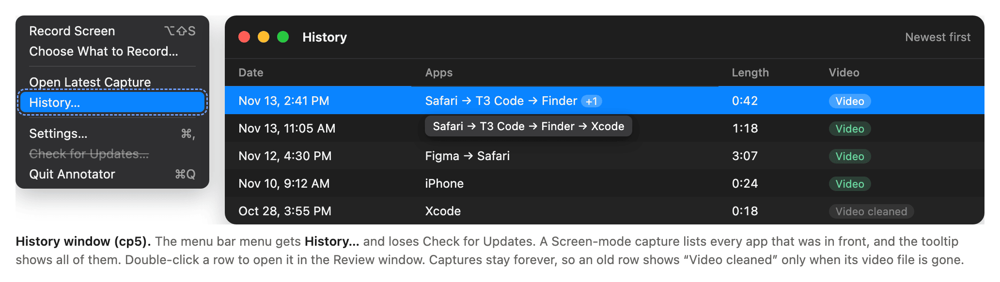
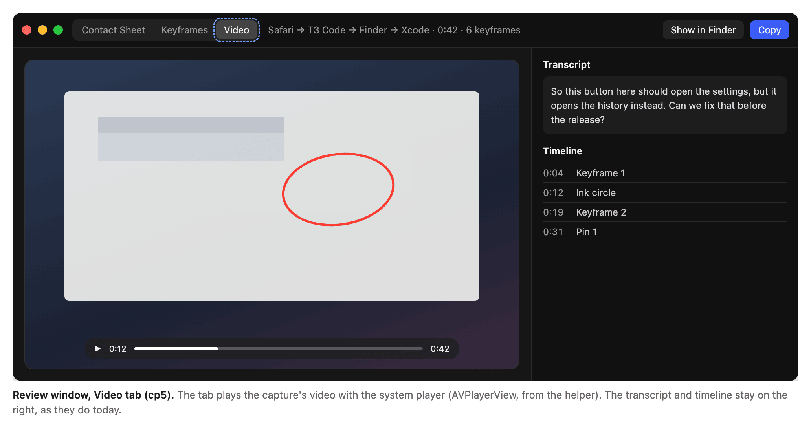

# Video export, retention and shrinking

Read this before changing `src/export/`, `src/retention.rs`, `helper/Export.swift` or `helper/Media.swift`.

## Video export (`src/export/`, `helper/Export.swift`)

`scrawl export <bundle>` writes one H.264/HEVC + AAC `.mp4`; the `videoExport` flag (default off) only gates the menu's **Export Last Capture as Video…** (→ `~/Movies/Scrawl`, progress beside the menu bar icon). Rust decides everything and the helper renders it from a JSON plan (AVAssetReader → Core Image crop/camera → Core Graphics ink → AVAssetWriter): `crop.rs` (`--crop auto|full|x,y,w,h` — auto is `autocrop` `Scope::Whole` — even-sided output size, audio window), `ink.rs` (strokes via `sketch::freehand_outline`, laser, pins, ripples; sizes mirror `render::annotate_keyframe_in_place`), `camera.rs` (`--zoom`: pure events → camera rects, critically damped springs, never zooms during fast cursor travel; derived from ScreenDemon's click zoom). Everything in the plan is on the video's clock (bundle time − `videoOffsetMs`); Mac `audio.wav` starts `videoOffsetMs` in, an iPhone movie uses its own audio. Output is constant frame rate (screen movies only have frames on change). Test with `cargo test export::`.

## Retention and shrinking (`src/retention.rs`, `Media.shrink` in `helper/Media.swift`)

The app's `retention` worker (utility QoS) runs a pass 90 s after launch and hourly (`PASS_EVERY`): heavy media (`handoff::HEAVY_MEDIA`, plus `zoom/` from `DERIVED_MEDIA`) to the Trash after `mediaDays` (writes `.media-cleaned`), whole bundles after `bundleDays`; both default to `null` (keep forever, also when a field is missing); `"retention"` in `~/.config/scrawl/config.json`, Settings › Storage. It skips bundles under a day old or whose folder changed (ctime) in the last day, live `.media-pending`/`.media-sending` markers, `.pinned`, `.deliver.json`, and bundles `retention::claim`ed. Cabled-iPhone `recording.mov` (> 6 Mbps) is re-encoded to HEVC at 1600 px a minute after `finalize_live_capture`, written beside the bundle and renamed over the original; sample times are kept, so `scrawl.json` is unchanged. Anything reading `video` must handle it missing (`retention::missing_media_reason`). Try passes on a temp folder with `scrawl clean --captures DIR --days-ahead N [--dry-run]`.

## History and the Video tab (`src/history.rs`, `helper/Player.swift`)

*The History window and its menu item (approved design mockup).*

**History…** in the menu opens `HistoryWindow` (`src/ui.rs`). `history::scan` reads every `*.scrawl` folder in `handoff::default_captures_dir`, skips one without a readable `scrawl.json`, and sorts newest first. Each row has:

- the date: `createdAtMs` in local time (`localtime_r`), with the year only when it is not this year.
- the apps: `ScrawlBundle::apps`. The Apps cell shows three, then "+N". The tooltip and the Review header show all of them.
- the length: `durationMs` as `M:SS`.
- "Video cleaned" when `history::playable_video` finds no file.

`ScrawlBundle::apps` gives one app list per capture mode:

| Mode | Apps |
|---|---|
| Screen | The app of each window-log snapshot's `frontmost` entry, in first-seen order |
| Area | The app of each snapshot's first layer-0 regular window, in first-seen order. The window log runs for Area captures too, over the region. |
| Window | `target.app` |
| iPhone | `device.app`, else `target.app` |

A Screen or Area capture with no app in its window log uses `target.app`. Captures made before Area captures logged windows are such captures. `windows::top_window` holds the per-snapshot rule. `windows::top_raw_window` applies the same rule and the window log's filters to a live `raw_windows()` list.

The summary keeps window open and close lines for Screen captures only.

Double-click or Return on a row opens it in Review. The Review window shows a **Video** tab only while `history::playable_video` finds the file `scrawl.json` names in `video` (resolved by `handoff::bundle_video`). For a paused recording, that file is the cut one. A row with its video opens on that tab. The tab starts `scrawl-helper play MOVIE --title T --frame X,Y,W,H`: an AVPlayerView window that plays at once, fitted to the movie's shape inside the Review stage. The Review window kills it when the tab, the capture or the window changes. Closing the player leaves the tab on a **Play** button.

*The Review window's Video tab (approved design mockup).* A cleaned capture opens on its contact sheet, with its keyframes and transcript.
